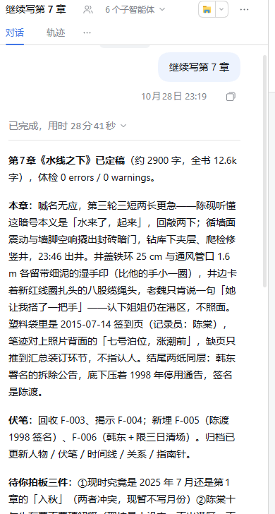
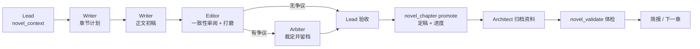
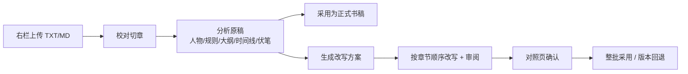

<div align="center">


# dsh-novel-studio · 小说工作室

**DeepSeek Harness 写作模式：四个角色协作写小说，支持半成品导入、剧情改写与版本回退。**

[](docs/CHANGELOG.md)
[](LICENSE)
[](package.json)
[](docs/ARCHITECTURE.md)

[功能](#功能) · [截图](#截图) · [快速开始](#快速开始) · [文档](#文档) · [开发](#开发)

</div>

---

## 这是什么

`dsh-novel-studio` 是一个装进 [DeepSeek Harness](https://github.com/deepseek-ai/deepseek-harness) 的本地 bundle。它向 profile 注入一个 Agent 预设——**小说工作室**——把写小说拆成一条可落盘、可审阅、可回退的流水线：

- **Lead（总编）** 调度、验收、对用户汇报；
- **Architect（架构师）** 管前提、世界观、人物与大纲；
- **Writer（作者）** 写章节计划与正文；
- **Editor（编辑）** 做一致性审阅与文字打磨；
- **Arbiter（裁定者）** 做语义裁定与路线判断。

所有产物都是普通文件：正文、章节摘要、人物卡、时间线、伏笔账本、审阅报告、裁定记录、导入批次、候选稿与版本快照。会话只是在文件之上协作，**项目目录才是唯一事实来源**。

## 功能

- **写作模式**：新会话选择「小说工作室」，四名角色由 Agent Teams 拉起，共享工作目录与任务板。
- **右栏「写作台」**：概览、章节目录与全文阅读、13 类资料库、导入改写入口；自动跟随当前会话的工作区。
- **半成品导入 / 剧情改写（0.2.0）**：上传 TXT/Markdown，校对切章，按块分析，归档故事资料；需要改稿时生成改写方案，按章节顺序改写、审阅、对照，最后整批采用。
- **版本与回退**：每次正式交付生成受管版本快照；可恢复旧版本，回退前的修改也会保留为版本。
- **资料即记忆**：人物、世界规则、大纲、时间线、伏笔、关系、文风卡、摘要、裁定实时归档；`novel_context` 按章组装有界上下文包。
- **确定性工具**：项目识别 / 导入切章 / 上下文包 / 资料体检 / 定稿与导出 / 导入改写，共 6 个 `novel_*` 工具；避免模型手写核心状态。
- **一键导出**：整本 Markdown 或 DOCX（纯 Node 生成 OOXML，无外部依赖）。
- **可自检**：Host 内置 `/novel-studio/api/status`，不建会话即可核对 preset、工具、技能与 Client 入口。

## 截图

<table>
<tr>
<td width="62%"></td>
<td width="38%" valign="top"></td>
</tr>
<tr>
<td><sub>右栏写作台：雾港夜航 · 7 章已定稿、12,581 字、5 条未回收伏笔；最近章节、资料库、下一章与导出入口。</sub></td>
<td><sub>多 Agent 协作：Lead 拉起「6 个子智能体」推进第 7 章，完成后给出章节简报与伏笔回收清单。</sub></td>
</tr>
</table>

## 快速开始

### 1. 环境

- DeepSeek Harness Desktop 或 Web（需要 Agent Presets；团队协作依赖 Agent Teams）；
- Node.js ≥ 20；
- 已在 DSH 中配置可用模型。

### 2. 安装

```powershell
git clone https://github.com/lingran7031/dsh-novel-studio.git
```

然后在 DSH 里安装这个本地 bundle（二选一）：

- **插件管理器**：在 Creator 模式会话中让 Agent 调 `plugin_manager` 的 `install_bundle`，目标填克隆目录的绝对路径；
- **CLI**：`dsh plugin --profile <profile> add "file:<克隆目录绝对路径>"`（不同 DSH 版本命令可能略有差异）。

安装后刷新页面。**新建一个会话**，在 Agent 预设里选择 **小说工作室**。

> 说明：本仓库是 `private` 的本地 bundle，尚未发布到 npm。安装采用本地目录 link，修改代码后需在插件管理器里「禁用 → 启用」或重启 DSH 生效。

### 3. 五分钟试用：打开「雾港夜航」

仓库自带一个已归档的演示项目：

```
samples/雾港夜航/
```

它现在有 **7 章正文、12,581 字、10 个人物、7 条世界设定、6 条伏笔（5 条未回收）、2 份裁定记录**，停在第 7 章末尾。

1. 新建「小说工作室」会话，工作区选择 `samples/雾港夜航`；
2. 输入：

   > 继续写第 8 章。

3. 会话里会看到 Lead 读取状态、生成上下文、调用作者/编辑推进；右栏「写作台」会同步显示章节、资料与进度。

也可以从零开新书：

> 开一本都市悬疑：主角是法医，基调冷峻克制，目标 30 章。先给我前提、人物和 12 章大纲。

## 截图与文档

| 文档 | 内容 |
|---|---|
| [使用指南](docs/USAGE.md) | 安装、模式入口、新书 / 续写 / 改写、常用提示词、FAQ |
| [右栏写作台](docs/PANEL.md) | 面板标签、章节阅读、资料库、接口、刷新与安全边界 |
| [导入与剧情改写](docs/IMPORT-REWRITE.md) | 0.2.0 上传 → 切章 → 分析 → 方案 → 顺序改写 → 采用/回退 |
| [架构设计](docs/ARCHITECTURE.md) | bundle 组成、四个角色、工具 / 技能 / 路由、版本存储、数据流 |
| [数据格式](docs/DATA-FORMAT.md) | 项目目录结构与各资料文件字段 |
| [开发指南](docs/DEVELOPMENT.md) | 开发循环、测试、自检、常见故障、发布清单 |
| [验收记录](docs/ACCEPTANCE.md) | 人工验收步骤与检查清单 |
| [验证记录](docs/VERIFICATION.md) | 测试证据、演示项目数据、真实会话观察 |
| [变更记录](docs/CHANGELOG.md) | 0.1.0 → 0.2.0 变更 |

## 协作模式

| 角色 | 职责 | 主要产物 |
|---|---|---|
| **Lead 总编** | 调度、验收、定稿、对用户汇报 | `chapters/NNN.md`、`meta/progress.json`、摘要、简报 |
| **Architect 架构师** | 前提、世界观、人物、卷/弧/章大纲；每章后归档资料 | `premise.md`、`characters.json`、`world_rules.json`、`outline.json`、`timeline.jsonl`、`foreshadow_ledger.json` |
| **Writer 作者** | 章节计划 + 正文初稿 | `story/plans/NNN.md` → `story/drafts/NNN.md` |
| **Editor 编辑** | 一致性审阅 + 文字打磨 | `story/reviews/NNN.md`、`story/polished/NNN.md` |
| **Arbiter 裁定者** | 语义裁定、路线判断、裁定留档 | `story/decisions/NNNN-*.md`、`meta/compass.json` |

角色宪章放在 `skills/novel-role-*`，按需加载；Lead 的总编手册在 `skills/novel-studio`，单章循环在 `skills/novel-chapter`，导入与改写在 `skills/novel-import` / `skills/novel-rewrite`。

## 工作流

**日常章节循环**



默认自动推进；故事蓝图、卷末 / 大转折、影响主线的裁定、用户叫停时暂停。

**半成品导入与剧情改写（0.2.0）**



## 右栏「写作台」

- 打开：会话页右上角「展开右栏」→ 右栏顶部 `+` → 指南卡片「写作台」。
- **概览**：书名、项目目录、阶段、章节数 / 已定稿数、总字数、未回收伏笔、裁定数、最近章节、下一章快捷操作。
- **章节**：按目录阅读全文，支持搜索、上/下一章、字号、复制正文。
- **资料库**：13 类资料（前提、人物、世界规则、大纲、时间线、伏笔、关系、指南针、文风卡、摘要、审阅、裁定、续写方案），支持搜索与全文查看。
- **导入改写**：0.2.0 的导入、分析、方案、改写与版本操作入口。
- **操作**：复制「继续写第 N 章」指令；导出 Markdown / DOCX 到 `export/`。

接口与安全边界见 [docs/PANEL.md](docs/PANEL.md)。所有接口按当前会话 `sessionId` 解析项目目录，也支持显式 `path=`；章节 / 资料读接口只访问约定文件，单文件上限 8 MiB，并检查符号链接真实目标。

## 工具

只有「小说工作室」模式可见（作用域隔离）。

| 工具 | 用途 |
|---|---|
| `novel_project` | `detect` 识别项目 / `init` 建骨架 / `status` 进度与缺失资料 |
| `novel_context` | 按章组装有界上下文包（前提、大纲、最近摘要、上一章结尾、人物 / 规则 / 伏笔 / 裁定、文风卡） |
| `novel_validate` | 资料 JSON、字段、引用、时间线、章节连续性、进度与摘要覆盖体检 |
| `novel_chapter` | `promote` 定稿（覆盖保护 + `.bak`）/ `summary` / `checkpoint` / `export` md+docx |
| `novel_import` | 旧版导入：切章分块、清单、章节归位（`story/import/`） |
| `novel_rewrite` | 0.2.0 导入分析、改写方案、顺序改写、候选审阅、资料同步与最终验收 |

## 项目目录（最小视图）

```
<novel-root>/
  premise.md
  chapters/001.md …
  outline.json / layered_outline.json
  characters.json / world_rules.json / foreshadow_ledger.json / relationship_state.json
  timeline.jsonl
  meta/progress.json / meta/compass.json
  story/
    plans/ drafts/ reviews/ polished/ summaries/ decisions/
    style.md  state.json  continuation-plan.md
    imports/ rewrites/ versions/     # 0.2.0 导入、候选改写与版本快照
  export/novel.md / novel.docx
```

完整字段与目录见 [docs/DATA-FORMAT.md](docs/DATA-FORMAT.md)。

## 兼容性与已知限制

- 数据格式与 `dsh-novel-workbench` 的读取约定兼容（前提 / 人物 / 世界规则 / 大纲 / 时间线 / 伏笔 / 关系 / 进度）。
- 导入支持 `.txt` / `.md`，UTF-8 与 GB18030；单份原稿上限 16 MiB，资料单文件展示上限 8 MiB。扫描版 PDF / 图片小说需先转文本。
- 改写首版保持章节数量与顺序，不做自动增删、拆合或重排。
- 客户端 UI 更新后需要刷新页面；preset / 服务端代码更新通常需要「禁用 → 启用 bundle」或重启 DSH。
- Agent Teams 依赖 DSH 的 experimental Team 包；缺少时写作仍可进行，但团队协作能力会降级。

## 开发

```powershell
# 语法检查全部服务端模块
Get-ChildItem lib -Filter *.js | ForEach-Object { node --check $_.FullName }

# 冒烟测试 + 端到端验收（60 项）
node test/smoke.mjs
node test/acceptance.mjs
```

自检路由（端口以当前 GUI 启动日志为准）：

```powershell
curl.exe http://127.0.0.1:<port>/novel-studio/api/status
```

返回 preset 花名册与子插件 `fiberState`、模式内工具 / 技能、提示词装配结果、Client 入口等。详见 [docs/DEVELOPMENT.md](docs/DEVELOPMENT.md)。

## 文档

- [使用指南](docs/USAGE.md)
- [右栏写作台](docs/PANEL.md)
- [导入与剧情改写](docs/IMPORT-REWRITE.md)
- [架构设计](docs/ARCHITECTURE.md)
- [数据格式](docs/DATA-FORMAT.md)
- [开发指南](docs/DEVELOPMENT.md)
- [验收记录](docs/ACCEPTANCE.md)
- [验证记录](docs/VERIFICATION.md)
- [变更记录](docs/CHANGELOG.md)

## License

MIT © 2026 [lingran7031](https://github.com/lingran7031)
