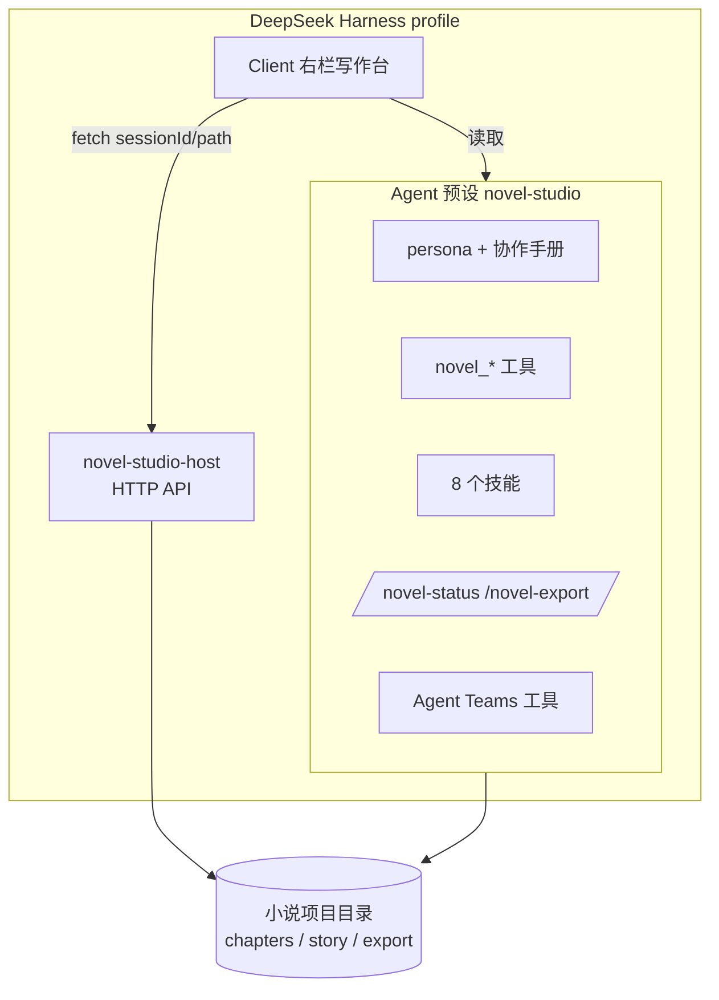

# 架构设计

## 1. 定位

`dsh-novel-studio` 是一个本地 Cordis bundle，向 DeepSeek Harness 的 profile 注入：

1. 一个 **Agent 预设**「小说工作室」（id `novel-studio`）；
2. 一组**只在该预设作用域内可见**的模型工具（6 个 `novel_*`）、技能包（8 个）与斜杠命令（2 个）；
3. 一个 **Host HTTP 服务**（自检、写作台数据、导入改写、导出）；
4. 一个 **Client 插件**（右栏「写作台」标签页）。

所有创作状态都写在小说项目目录里；Harness 只负责运行角色、拼装提示词与转发工具调用。



## 2. Bundle 组成

### 2.1 包清单

| 文件 | 作用 |
|---|---|
| `package.json` | bundle patch、`./client` 导出、`dsh.client` 声明、展示元数据 |
| `cordis.patch.yml` | 包根 Host 行、Host 服务行、preset 声明 |
| `lib/host.js` | 自检 / 项目 / 章节 / 资料库 / 导出路由 |
| `lib/workflow-http.js` | 导入改写 / 版本 API |
| `lib/workbench.js` | 章节与资料库只读读取、路径边界与大小限制 |
| `lib/revisions.js` | 导入批次、候选改写、版本快照、锁与事务恢复 |
| `lib/rewrite-runtime.js` | 用当前会话真实 Agent 派发分析 / 改写任务 |
| `lib/rewrite-tools.js` | 模型工具 `novel_rewrite` |
| `lib/mode.js` | 常驻协作提示词 section |
| `lib/skills.js` | 从包内 `skills/` 注册运行时技能 |
| `lib/commands.js` | `/novel-status`、`/novel-export` |
| `lib/tools.js` | 5 个基础工具 + 挂载 `novel_rewrite` |
| `lib/core.js` | 纯函数：项目识别、上下文包、校验、导出、DOCX |
| `lib/docx.js` | 纯 Node OOXML DOCX 生成 |
| `lib/client.js` | 右栏写作台（概览 / 章节 / 资料库 / 导入改写） |

### 2.2 Host 行

| 行 id | 插件 | 说明 |
|---|---|---|
| `novel-studio-ui` | `dsh-novel-studio` | 包根空插件，供 Client 扫描与 Loader 挂载 |
| `novel-studio-host` | `dsh-novel-studio/host` | HTTP 路由，`inject: ['webServer']` |
| `preset-novel-studio` | `@deepseek-ai/dsh-agent-preset` | 声明 preset `novel-studio` |

### 2.3 Preset 子插件

当前 composition 共 16 行（组展开后）：persona、文件读写工具、文件搜索、ask-user、todo、
`skill-filesystem` + `novel-skills`（运行时注册 8 个技能）+ `tool-skill`、压缩组、present、
`tool-subagent`（导入分析并行派发）、`novel-mode`（常驻手册）、`novel-tools`（6 个 `novel_*` 工具）、
`novel-commands`（2 个斜杠命令）。

全部子插件都挂在 preset 作用域内：其他模式看不到这些工具、技能和提示词。

## 3. 四个角色与交接契约

| 角色 | 核心职责 | 写文件范围 |
|---|---|---|
| Lead 总编 | 调度、验收、定稿、对用户汇报 | `chapters/`、`meta/`、`story/summaries/` |
| Architect 架构师 | 前提、世界观、人物、大纲、每章资料归档 | 资料类文件 + `timeline/foreshadow/relationship` |
| Writer 作者 | 章节计划与正文 | `story/plans/`、`story/drafts/` |
| Editor 编辑 | 一致性审阅与打磨 | `story/reviews/`、`story/polished/` |
| Arbiter 裁定者 | 语义裁定与路线判断 | `story/decisions/` |

角色宪章由技能按需加载（`novel-role-*`）。交接契约：**回复 ≤ 300 字，正文只落盘，不搬进 Lead 上下文**。
Lead 的跨章上下文由 `novel_context` 生成的有界上下文包控制（默认约 5000 tokens）。

## 4. 工具与技能

### 工具（仅在写作模式可见）

| 工具 | 关键能力 |
|---|---|
| `novel_project` | `detect` / `init` / `status` |
| `novel_context` | 有界上下文包 + 缓存 `story/context/` |
| `novel_validate` | 资料结构、引用、时间线、章节连续性、进度与摘要覆盖 |
| `novel_chapter` | `promote`（覆盖保护 + `.bak`）/ `summary` / `checkpoint` / `export` md+docx |
| `novel_import` | 旧版导入：`prepare` / `status` / `materialize` |
| `novel_rewrite` | 0.2.0 导入分析、改写方案、顺序候选、资料同步、最终验收 |

### 技能（8 个）

`novel-studio`（总编手册）、`novel-chapter`（单章循环）、`novel-import`（旧版导入）、
`novel-rewrite`（导入改写）、`novel-role-architect`、`novel-role-writer`、
`novel-role-editor`、`novel-role-arbiter`。

技能由 `lib/skills.js` 读取 `skills/<name>/SKILL.md`，以 `source: 'runtime'` 注册进 preset 作用域。
技能正文与 frontmatter 修改后需要重新加载插件才会生效。

### 命令

| 命令 | 行为 |
|---|---|
| `/novel-status` | 直接读取项目状态并返回文本，不触发模型 |
| `/novel-export [md\|docx]` | 直接导出整本，不触发模型 |

## 5. Host HTTP API

全部路由前缀 `/novel-studio/api`，带 Host 头回环信任围栏；修改类请求还要求同源 JSON。

| 方法 | 路径 | 用途 |
|---|---|---|
| GET | `/status` | preset 自检：花名册、composition 行状态、工具/技能、提示词装配、Client 入口 |
| GET | `/project` | 写作台概览与完整章节目录 |
| GET | `/chapter?chapter=N` | 单章全文阅读 |
| GET | `/library` | 13 类资料库 |
| POST | `/export` | 导出 `export/novel.md` / `novel.docx` |
| GET | `/workflow` | 导入批次、改写任务、版本列表、运行能力 |
| GET | `/import?importId=` | 导入批次切章 |
| GET | `/compare?rewriteId=&chapter=` | 原稿 / 候选 / 修改摘要 / 审阅意见 |
| GET | `/revision-library?rewriteId=&kind=original\|candidate` | 原稿或候选版资料库 |
| POST | `/workflow` | 导入、切章、分析、方案、开始/暂停、采用、回退等 |
| GET | `/client/rebuild` | 开发辅助：让 clientModules 重新读取 Client 产物 |

项目解析：优先 `?sessionId=` 对应活 Agent / 持久 Session 的 `cwd`，也支持显式 `?path=`；无根目录返回 `no-project-root`。

## 6. Client 写作台

- 通过 `ctx.sidebarRightTabs.register({ id, kind, title, keepMounted, guide })` 注册页面类型，`guide` 条目使用 **thunk** 的 `title()` / `description()`（官方要求，字符串会导致指南页崩溃）；
- 在 `sidebar.right.pane.tab` 与 `sidebar.right.pane.tab.title` 两个 keyed 座位按同一 id 渲染；
- 组件通过 Slot 注入的 `sessionId` 调 Host 接口；概览 5 秒轮询、资料库 10 秒轮询，页面不可见时暂停；
- 展示状态固定到当前项目：切换会话或工作目录时清空旧章节 / 资料缓存；
- 读取受 `lib/workbench.js` 约束：仅约定文件与目录、校验符号链接真实目标、单文件 8 MiB 上限、明确错误不静默截断。

## 7. 存储与版本

```
story/imports/<importId>/        # 原始字节、归一化原文、切章、分析、来源哈希
story/rewrites/<rewriteId>/      # 冻结原稿、要求、方案、队列、审阅、候选项目
story/versions/<versionId>/      # 正式稿与资料的受管快照（project/ + manifest.json）
story/versions/index.json        # activeVersionId / currentHash / versions[]
story/versions/transaction.json  # 采用或回退事务日志（崩溃恢复用）
```

- 采用（apply）与回退（rollback）在项目根锁下执行，写事务日志后替换受管文件，成功后清理事务；
- 崩溃或中断后下次访问会依据 `transaction.json` 恢复；
- 每次正式交付生成版本快照；回退前的当前修改先存为新版本，导入证据与候选历史不会被删除；
- 版本快照覆盖正文与受管资料（章节、计划、草稿、审阅、摘要、裁定、资料文件、进度与指南针）。

## 8. 改写任务调度

- 面板的操作（`analyze` / `plan` / `run` / `start` / `resume` / `retry`）通过 `rewrite-runtime.js` 派发给**当前会话的真实 Agent**；
- 派发前检查：当前会话是否存在、工作目录是否仍匹配、会话是否忙碌、预设能力是否可用；
- 模型执行期间只写候选批次；采用与回退必须由用户在面板确认，模型不能直接改正式稿；
- 章节按依赖顺序领取，带领取令牌与版本校验；暂停后旧提交会被拒绝，恢复从最早未完成章节继续。

## 9. 设计约束

- **零宿主依赖**：预设子插件以本地目录 link 安装，运行时解析不到 `@deepseek-ai/*`，因此工具使用原生 JSON Schema + Node 内建模块；
- **Client 更新需要刷新页面**；preset / Host 模块更新通常需要禁用→启用 bundle 或重启 DSH（ESM 缓存）；
- **Agent Teams 为实验能力**：缺失时写作闭环仍可用，但团队协作降级；
- **改写首版不增删/重排章节**，只做局部、连续章段或全稿改写。
