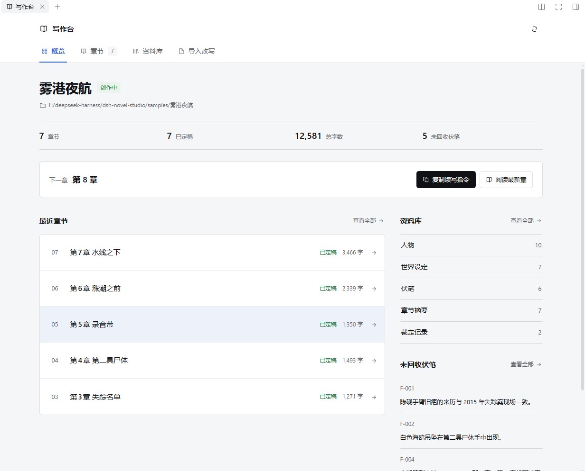

# 右栏「写作台」

写作台是 `dsh-novel-studio` 的 Client 半：一个右栏标签页，用来在不打断对话的情况下查看项目、读章节、翻资料和进入导入改写。

> 演示项目 `samples/雾港夜航`：7 章已定稿、12,581 字、5 条未回收伏笔，下一章第 8 章。

## 打开方式

1. 会话页右上角点「展开右栏」；
2. 右栏顶部 `+` → 指南卡片 **写作台**；
3. 同一个 `+` 菜单可以反复打开；标签会保留在当前会话的右栏布局里。

如果 `+` 菜单里没有「写作台」：先硬刷新页面（`Ctrl+Shift+R`），仍没有则重启 DSH。
如果「开始」页打开后空白：通常是 Client 产物未更新或槽位注册报错，见文末排查。

## 标签页

### 概览

- 书名、项目绝对路径、阶段徽章（准备创作 / 资料已导入 / 创作中 / 审阅中 / 已完成）；
- 章节数、已定稿数、总字数、未回收伏笔数；
- 「下一章」卡片：复制续写指令、阅读最新章；
- 最近章节列表（章号、标题、字数、定稿状态、进入阅读）；
- 资料库摘要（人物、世界设定、伏笔、章节摘要、裁定记录等数量）与未回收伏笔列表。

页面可见时每 5 秒自动刷新；右上角 ⟳ 可手动刷新。

### 章节

- 完整章节目录（按章号倒序，可搜索章号或标题）；
- 点击任意章进入阅读：返回目录、上一章 / 下一章、字号缩放、复制全文；
- 打开章节时才读取全文，不在轮询里加载所有正文。

### 资料库

13 类资料，对应项目中的文件或目录：

| 分类 | 来源 |
|---|---|
| 故事前提 | `premise.md` |
| 人物 | `characters.json` |
| 世界设定 | `world_rules.json` |
| 大纲 / 分层大纲 | `outline.json` / `layered_outline.json` |
| 时间线 | `timeline.jsonl` |
| 伏笔 | `foreshadow_ledger.json` |
| 人物关系 | `relationship_state.json` |
| 故事指南针 | `meta/compass.json` |
| 文风卡 | `story/style.md` |
| 章节摘要 | `story/summaries/*.md` |
| 审阅报告 | `story/reviews/*.md` |
| 裁定记录 | `story/decisions/*.md` |
| 续写方案 | `story/continuation-plan.md` |

- JSON 数组逐条展示；分层大纲保留嵌套字段；Markdown 展示全文；
- 支持按名称 / 内容搜索；
- 损坏 JSON、JSONL 坏行会明确提示文件名与错误，不会伪装成空资料；
- 资料库打开时每 10 秒刷新，切走后停止轮询并保留筛选与选中项。

### 导入改写

0.2.0 的导入、切章、分析、方案、顺序改写、采用与版本回退入口，支持尚未初始化的小说话目录。
完整流程见 [IMPORT-REWRITE.md](IMPORT-REWRITE.md)。

## 数据接口

所有接口都在 `/novel-studio/api` 下，使用当前会话 `sessionId` 解析项目目录，也支持显式 `path=`。

| 方法 | 路径 | 返回 |
|---|---|---|
| GET | `/project` | 概览：书名、阶段、章节列表、资料计数、未回收伏笔、最近章节 |
| GET | `/chapter?chapter=N` | 单章 `{chapter:{n,title,chars,completed,file,content}}` |
| GET | `/library` | 13 类资料卡片与条目 |
| POST | `/export` | 导出 Markdown / DOCX，返回目标路径 |
| GET | `/workflow` | 导入批次、改写任务、版本列表、当前会话派单能力 |
| GET | `/import?importId=` | 导入批次切章 |
| GET | `/compare?rewriteId=&chapter=` | 原稿 / 候选 / 修改摘要 / 审阅 |
| GET | `/revision-library?rewriteId=&kind=original\|candidate` | 原稿或候选版资料库 |
| POST | `/workflow` | 导入改写与版本操作（详见 IMPORT-REWRITE） |

## 读取边界与安全

- 读写路径限定在项目目录的约定文件 / 目录内；
- 检查符号链接的真实目标，拒绝跨出项目目录；
- 资料单文件展示上限 **8 MiB**；导入请求体上限 **32 MiB**，原稿文件上限 **16 MiB**；
- 非 UTF-8、损坏 JSON、超限文件返回明确错误，不静默截断正文；
- Host 路由带 Host 头回环信任围栏；修改类请求要求同源 `application/json`；
- 面板切换会话 / 工作目录时清空旧项目状态，避免串书。

## 刷新与缓存

- Client 代码随页面加载；插件更新后需要刷新页面；
- 概览 5 秒、资料库 10 秒轮询；页面不可见时暂停；
- 章节正文按需读取，不会随轮询反复加载；
- 打开面板显示的是**当前会话**的项目；切换会话后自动重新解析。

## 排查清单

| 现象 | 优先检查 |
|---|---|
| `+` 里没有「写作台」 | 硬刷新页面；检查 Client 入口是否在 boot graph |
| 「开始」页空白 | DevTools Console 是否有 slot 渲染错误；确认 guide 的 title/description 是函数（thunk） |
| 面板一直「正在读取」 | 自检接口是否正常；当前会话是否有可用工作目录 |
| 「这里还没有小说项目」 | 让 Lead 初始化当前目录，或在已有小说目录打开会话 |
| 章节/资料报错 | 对应文件是否 JSON 合法、是否超过 8 MiB、是否在项目目录内 |
| 导入改写按钮不可用 | 当前会话必须是「小说工作室」预设；会话忙碌或目录变化时需重试 |

接口返回与字段的更多细节见 [ARCHITECTURE.md](ARCHITECTURE.md) 与 [DEVELOPMENT.md](DEVELOPMENT.md)。
